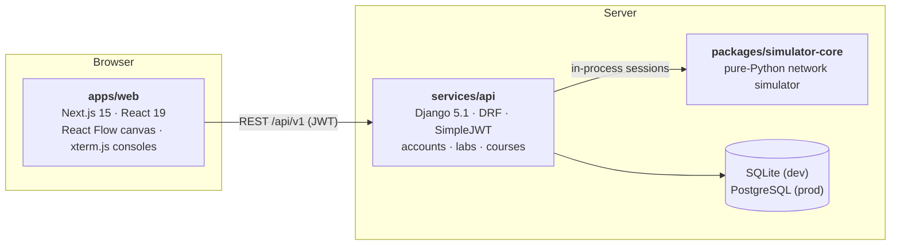

<div align="center">

# NetLab Academy

**A browser-based networking lab for CCNA and CCNP learners.**<br/>
Build topologies on a CML-style canvas, start them, and configure switches,
routers and PCs from an IOS-style console, all in the browser.

<br/>


<!-- LOC-BADGE:START -->

<!-- LOC-BADGE:END -->
[](https://github.com/happy-kitty0821/NetlabAcademy/actions/workflows/lines-of-code.yml)

[Features](#features) &nbsp;·&nbsp;
[Architecture](#architecture) &nbsp;·&nbsp;
[Getting started](#getting-started) &nbsp;·&nbsp;
[Testing](#testing) &nbsp;·&nbsp;
[Lines of code](#lines-of-code) &nbsp;·&nbsp;
[Status](#project-status)

</div>

> [!NOTE]
> NetLab Academy is an independent educational project and is not affiliated
> with Cisco Systems. The simulator is an original software model of network
> behaviour. It does not run Cisco IOS and is not Cisco Packet Tracer or
> Cisco Modeling Labs.

---

## Features

### Lab workspace

| | |
| :-- | :-- |
| **Canvas** | CML-style workbench: drag devices from the palette, link them, move them around. Devices are icon tiles with a stopped/started badge. |
| **Links** | Drag from a device's connector to another device, then pick the exact port at each end (`Fa0/1`, `Gi0/0`, `eth0`). Parallel cables are drawn side by side. |
| **Run the lab** | Start, stop and wipe the simulation. Links can be added or removed while the lab runs, and ports come up or go down live. |
| **Consoles** | One terminal tab per device, with `?` help, tab completion and IOS-style errors. |
| **Lab log & packet trace** | Syslog from every device (`%LINK-3-UPDOWN`, `%LINEPROTO-5-UPDOWN`, `%CDP-4-NATIVE_VLAN_MISMATCH`, ...) and a step-by-step packet trace. |
| **Saved labs** | Save, open and manage labs per user, as tiles or a list. |

### Network simulator

| Area | What is modelled |
| :-- | :-- |
| **Devices** | Catalyst 2960 switch, ISR 2911 router, PCs, laptops and servers |
| **Layer 2** | Ethernet, MAC learning, ARP, ICMP (`ping`), CDP neighbours |
| **VLANs** | VLAN database, access ports, 802.1Q trunks, allowed lists, native VLAN, DTP (`dynamic auto` / `desirable`, `nonegotiate`), inactive ports for deleted VLANs |
| **Spanning tree** | Per-VLAN PVST+ / Rapid-PVST+, `root primary` / `secondary`, priority, port cost and port priority, PortFast, BPDU guard, VLAN ranges (`spanning-tree vlan 1-100 ...`) |
| **Layer 3** | Router interfaces and subinterfaces (router-on-a-stick), connected and static routes, switch SVIs, default gateways |
| **EtherChannel** | LACP and PAgP mode negotiation |
| **CLI** | User / privileged / config modes, `show` commands with IOS-style output, `do`, `|` filters, `interface range`. PCs also take `ipconfig` |
| **Engine** | Deterministic discrete-event simulation with replayable traces, implemented in pure Python with no runtime dependencies |

### Platform

- JWT authentication with persistent users and **Admin / Instructor / Student** roles, enforced by the API
- Admin user management
- Labs dashboard and sample labs

---

## Architecture



The simulator is a standalone package: it can be imported, tested and run
without Django, a database or the web app. The API holds one simulation
session per running lab and turns console commands, link changes and pings
into calls on it.

---

## Repository layout

```text
NetlabAcademy/
├── apps/
│   └── web/                    Next.js frontend (canvas, consoles, dashboard, admin)
├── services/
│   └── api/                    Django + DRF backend
│       └── apps/
│           ├── accounts/       users, roles, JWT auth
│           ├── labs/           saved labs + simulation sessions
│           └── courses/        course content
├── packages/
│   └── simulator-core/         standalone network simulator (stdlib only)
│       ├── simulator_core/     engine, devices, CLI, STP, routing, CDP
│       └── tests/
├── docs/                       design notes and reports
├── .github/
│   ├── workflows/              GitHub Actions (lines-of-code)
│   └── scripts/loc.py          line counter used by the workflow
├── run_project.py              one-command development launcher
└── PROJECT_SPEC.md             product specification
```

---

## Getting started

### Prerequisites

| Tool | Version |
| :-- | :-- |
| Python | 3.12 or newer |
| Node.js | 20 or newer |
| git | any recent version |
| PostgreSQL | 15 or newer (production only; development uses SQLite) |

### One command

```sh
python run_project.py
```

The launcher creates the Python virtual environment, installs the backend,
simulator and frontend dependencies, runs the migrations, builds the
frontend and starts both servers:

| Service | URL |
| :-- | :-- |
| Web app | http://localhost:3000 |
| API | http://localhost:8000/api/v1/ |
| Django admin | http://localhost:8000/admin/ |
| Health check | http://localhost:8000/health/ |

Options: `--skip-pull`, `--skip-frontend-build`, `--skip-migrate`.
Press <kbd>Ctrl</kbd>+<kbd>C</kbd> to stop both servers.

<details>
<summary><b>Manual setup</b></summary>

#### Backend API

```sh
cd services/api
python -m venv ../venv
# Windows: ..\venv\Scripts\activate   macOS/Linux: source ../venv/bin/activate
pip install -r requirements.txt
pip install -e ../../packages/simulator-core
cp .env.example .env          # set SECRET_KEY etc.
python manage.py migrate
python manage.py createsuperuser
python manage.py runserver
```

#### Frontend

```sh
cd apps/web
npm install
cp .env.local.example .env.local
npm run dev
```

</details>

---

## Testing

| Suite | Command |
| :-- | :-- |
| Simulator | `cd packages/simulator-core && python -m pytest` |
| API | `cd services/api && python -m pytest` |
| Frontend type check | `cd apps/web && npx tsc --noEmit` |
| Frontend lint | `cd apps/web && npm run lint` |

---

## Lines of code

Updated automatically by the
[Lines of code workflow](.github/workflows/lines-of-code.yml) on every push
to `main`. Run `python .github/scripts/loc.py` to see the same table
locally.

<!-- LOC:START -->
| Language | Files | Code | Comments | Blank | Share of code |
| :-- | --: | --: | --: | --: | :-- |
| Python | 101 | 18,139 | 5,182 | 3,658 | `██████████████░░░░░░` 68.4% |
| TSX | 45 | 6,194 | 392 | 649 | `█████░░░░░░░░░░░░░░░` 23.4% |
| Markdown | 5 | 975 | 0 | 287 | `█░░░░░░░░░░░░░░░░░░░` 3.7% |
| TypeScript | 11 | 894 | 175 | 130 | `█░░░░░░░░░░░░░░░░░░░` 3.4% |
| CSS | 1 | 164 | 28 | 32 | `░░░░░░░░░░░░░░░░░░░░` 0.6% |
| JSON | 2 | 60 | 0 | 0 | `░░░░░░░░░░░░░░░░░░░░` 0.2% |
| YAML | 1 | 36 | 3 | 8 | `░░░░░░░░░░░░░░░░░░░░` 0.1% |
| TOML | 1 | 26 | 0 | 6 | `░░░░░░░░░░░░░░░░░░░░` 0.1% |
| JavaScript | 2 | 16 | 0 | 5 | `░░░░░░░░░░░░░░░░░░░░` 0.1% |
| INI | 1 | 4 | 0 | 0 | `░░░░░░░░░░░░░░░░░░░░` 0.0% |
| **Total** | **170** | **26,508** | **5,780** | **4,775** | |
<sub>Counted by <code>.github/scripts/loc.py</code> on every push to <code>main</code> (git-tracked files; lockfiles, migrations and this README excluded). Last updated 2026-11-28.</sub>
<!-- LOC:END -->

---

## Project status

| Area | Status |
| :-- | :-- |
| Network simulator (L2, VLANs, STP, DTP, L3, CDP, CLI) | Working, under active development |
| Lab workspace (canvas, consoles, live links, lab log) | Working |
| Saved labs | Working |
| Users, roles and admin user management | Working |
| Full role-based access control | In progress |
| Courses and exam engine | Planned |

---

## Design principles

- **Modular monolith.** One Django project with domain apps (`accounts`, `labs`, `courses`). No microservices without a measured need.
- **Independent simulator.** `packages/simulator-core` depends only on the Python standard library. It can be imported and tested without Django, a database or the frontend.
- **IOS fidelity first.** Command syntax, `show` output, error messages and protocol behaviour follow real Cisco IOS, and are checked by tests.
- **Deterministic.** A simulation with the same seed and the same commands produces the same trace, so labs can be replayed and graded.
- **Server-side security.** Roles are enforced on every API request; the frontend only reflects them.
